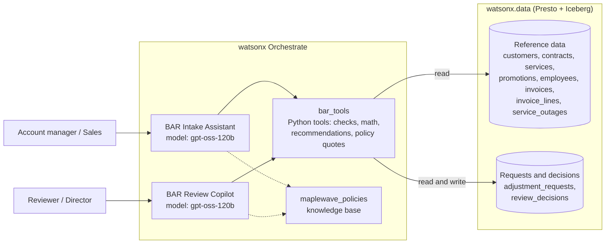

# Maplewave BAR Copilot

> **Maplewave and all its data are fictional.** This is a demo built for an IBM interview.

---

## The problem and the solution

A billing adjustment request (BAR) is how a business customer gets a credit when they were billed wrong. There are five types: a rate mismatch (billed at the wrong unit price), an SLA outage credit (downtime that breached the availability target), a promotion that was never applied, a duplicate charge, and an early termination fee dispute. Each type has its own policy, POL-101 through POL-105. POL-000 sets out what every request must include: the contract, the billing periods, the invoice IDs, the calculation, and the supporting evidence.

Today the account manager writes the request in free text. Most requests arrive missing at least one of those required fields. A reviewer then has to pull the contract, find the right invoices, check the outage records, work out the correct amount, verify the policy, and decide. If the amount is over $20,000 the request goes to a director. Over $100,000 it also needs the VP of Finance Operations.

The numbers from the synthetic data show how much this costs. 85% of the 374 past requests (318 of 374) came in incomplete. An incomplete request took an average of 49 minutes to review; a complete one took 16. The average time from submission to decision was 13.6 days for incomplete requests and 3.1 days for complete ones. Across all 374 requests, reviewers spent about 276 hours in total. On top of the time cost, incomplete requests often overclaim, for example asking for a credit on all 40 sites when only 30 were confirmed down. Manual math and policy checks introduce error and inconsistency.

The solution is two agents in watsonx Orchestrate. The first helps account managers build a complete, evidence-backed request before they submit it. The second gives reviewers a recommendation that was worked out in Python from the actual records and the policy, with the exact policy quote attached. The human always makes the final call. Every decision is saved, including the AI recommendation, the outcome, and the reason if the reviewer overrides.

---

## How it works

1. An account manager describes the billing problem in plain language to the **BAR Intake Assistant**.
2. The agent calls tools to find the customer, the contract, and the relevant invoices and outage records.
3. It calls the right check tool for the request type. The check tool runs the policy calculation in Python and returns the amount, the billing periods, the invoice IDs, the evidence IDs, and the exact policy quote.
4. The agent shows the account manager a draft. Every number in the draft came from a tool. The model did not calculate anything.
5. The account manager types `submit`. The agent calls `submit_request` and records the request in `adjustment_requests`.
6. The reviewer opens the **BAR Review Copilot** and sees the pending queue.
7. They ask for a review of a specific request. The agent calls `review_request`, which re-runs the same Python calculation against the live records and returns a recommendation.
8. The agent shows the recommendation with the policy quote. The reviewer decides: approve, partially approve, reject, or return for more information.
9. If the recommended amount is above $20,000, the tool sets `approval_level_required` to `Director` (POL-001 §1). The agent tells the reviewer and the request waits for a director.
10. If the amount is above $100,000, both a Director and the VP of Finance Operations must sign off (POL-001 §1).
11. The reviewer records their decision. If they override the recommendation they give a reason. The agent calls `record_decision` and saves everything to `review_decisions`.

---

## Architecture



Built with **IBM Bob**.

---

## Design choices

**Money math is in Python, not in the model.**
Every check tool (`check_rate_error`, `check_sla_credit`, `check_promotion`, `check_duplicates`, `check_etf`) and the `review_request` tool run the full calculation in Python using `Decimal`, rounded half-up to cents. The model receives the finished number and copies it. It never does arithmetic.

**Policy quotes come from the source files.**
The check tools embed the exact sentence from the relevant policy file. `tests/test_policy_quotes.py` asserts that every quote returned by every tool is word-for-word from the `.txt` file. If a policy file changes, the test fails.

**Approval authority is enforced in code.**
`record_decision` applies POL-001 §1: up to $20,000 a Reviewer can finalise, above that a Director is required, above $100,000 a Director and the VP of Finance Operations are required. The model never makes that determination.

**Every decision is on record.**
Each call to `record_decision` writes a row to `review_decisions` with the request ID, the AI recommendation, the final outcome, the approver, and the override reason when the reviewer disagreed.

**SQL is read-only and parameterised.**
All queries use parameters. The only writes in the system are `submit_request` (one insert to `adjustment_requests`) and `record_decision` (one insert to `review_decisions`).

---

## Setup

### 1. `.env` file

```
WXO_API_KEY=...        # watsonx Orchestrate API key
WXO_URL=...            # watsonx Orchestrate instance URL
WXD_USER=...           # watsonx.data Presto user
WXD_API_KEY=...        # watsonx.data API key
PRESTO_HOST=...
PRESTO_PORT=443
PRESTO_CATALOG=...
PRESTO_SCHEMA=...
```

### 2. Deploy to Orchestrate

```
python scripts\deploy.py
```

This activates your Orchestrate environment, registers the `maplewave_data` connection with credentials for draft and live, imports the `maplewave_policies` knowledge base, imports `bar_tools`, imports both agents, and deploys them to live.

### 3. Run tests

```
python -m pytest
```

`test_calculations.py` checks that every check tool and `review_request` return the correct amount for each request type.
`test_policy_quotes.py` checks that every policy quote the tools return is verbatim from the source `.txt` file.

### 4. Smoke-test the tools locally

```
python scripts\try_tools.py
```

Calls each tool against the live watsonx.data connection and prints the results.

---

## Repo layout

```
agents/          intake_agent.yaml, review_agent.yaml
knowledge/       POL-000 to POL-105 policy files + maplewave_policies.yaml
tools/           bar_tools.py (all check, submit, review and record tools)
scripts/         deploy.py, try_tools.py, check_data.py, remove_all.py
tests/           test_calculations.py, test_policy_quotes.py
docs/            DATA_DICTIONARY.md
```

## Website

Two simple branded pages, one per agent. A single command starts both:

```
python website\serve.py
```

| Agent | URL |
|---|---|
| BAR Review Copilot | http://localhost:8000/index.html |
| BAR Intake Assistant | http://localhost:8001/intake.html |

---

